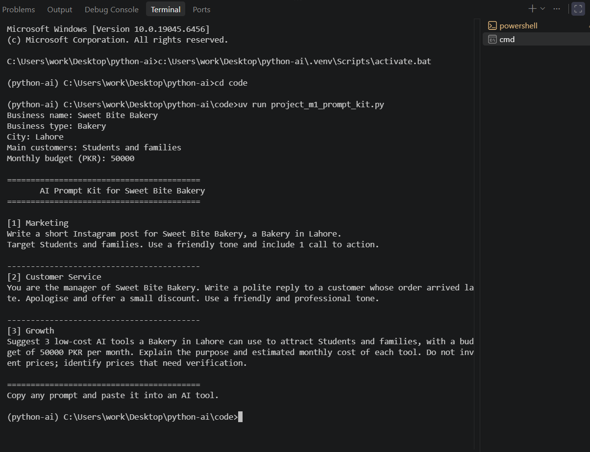

# Python for AI

**Student:** Ayesha Nasir

**Course:** Python for AI

## My AI Goal

My goal is to become an AI/ML Engineer and build practical AI solutions for real-world business problems.

## How to Run

Run the main program:

```bash
uv run main.py
```

Run the introduction task:

```bash
uv run code/lesson_01_intro.py
```

## Lessons Completed

- Lesson 1.1: Your AI Career Intro
- Lesson 1.2: Toolkit Proof
- Lesson 1.3: Client-Ready Repo
- Lesson 1.4: Business Prompt Builder 
- Lesson 1.5: AI Model Profile Card
- Lesson 1.6: Prompt Cleaner
- Lesson 1.7: Smart Model Router
- Lesson 1.8: Clinic Helper Bot


## Module 1 Project: AI Prompt Kit

A Python tool that turns a local business's details into 3 ready-to-use AI prompts.

**Run:** `uv run code/project_m1_prompt_kit.py`



**Who would pay for this:** Small business owners, such as bakery, salon, and shop owners, who want AI help with marketing, customer service, and business growth but don't know what to type.


## Task 1.8: Business Helper Bot Design

Business: Care Plus Clinic

| Intent | Keywords | Reply |
|---|---|---|
| Greeting | hi, hello, salam | Welcome and ask how to help |
| Timings | timing, hour, open | Opening hours |
| Fees | fee, price, cost | Consultation fee |
| Location | location, address, where | Clinic address |
| Appointment | appointment, book, visit | Contact reception |
| Complaint | complaint, problem, bad service | Apology and reception help |
| Unknown question | No matching keyword | Count question and prepare AI prompt |


## Module 1 Checkpoint 2: AI Front Desk

**Project:** Sweet Crumbs Bakery AI Front Desk

A Python-based front desk assistant that answers common customer questions, calculates order quotes with bulk discounts and delivery fees, prepares AI prompts for unknown questions, and estimates AI costs.

### Features
- Rule-based FAQ responses
- Complaint handling
- Order quotes for cupcakes, brownies, and chocolate cakes
- 10% bulk discount for orders of 10 or more items
- Free delivery for qualifying discounted subtotals
- Local and cloud AI prompt routing
- Session summary with quote totals and estimated AI costs

### How to Run

```bash
uv run code/project_m1_front_desk.py
```

### Project Files
- `code/project_m1_front_desk.py` — main program
- `docs/project-m1-part2-design.md` — design and rule tests
- `docs/project-m1-part2-results.md` — AI prompt testing and evaluation

### Example Result

A quote for 12 cupcakes has a subtotal of 3,000 PKR, a 300 PKR discount, a 200 PKR delivery fee, and a final total of **2,900 PKR**.

**Value:** The assistant gives consistent quotes and estimates AI costs before using an AI service.

**Note:** AI prompts and cost estimates are implemented; automatic model calls are not yet integrated.

- `docs/project-m1-part2-run-1.png` — terminal screenshot 1
- `docs/project-m1-part2-run-2.png` — terminal screenshot 2
